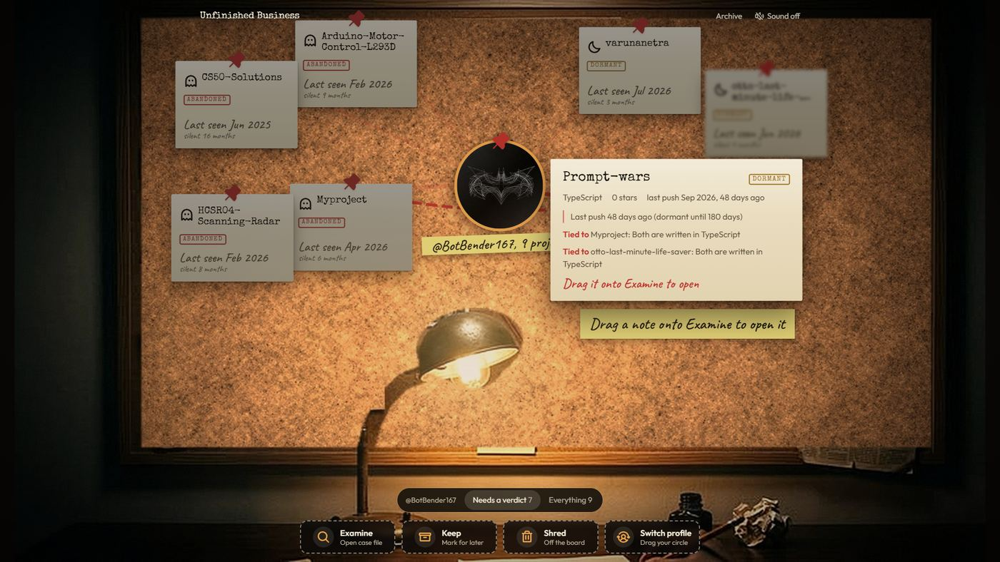
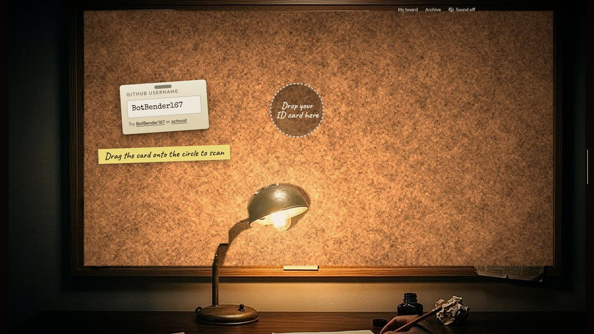
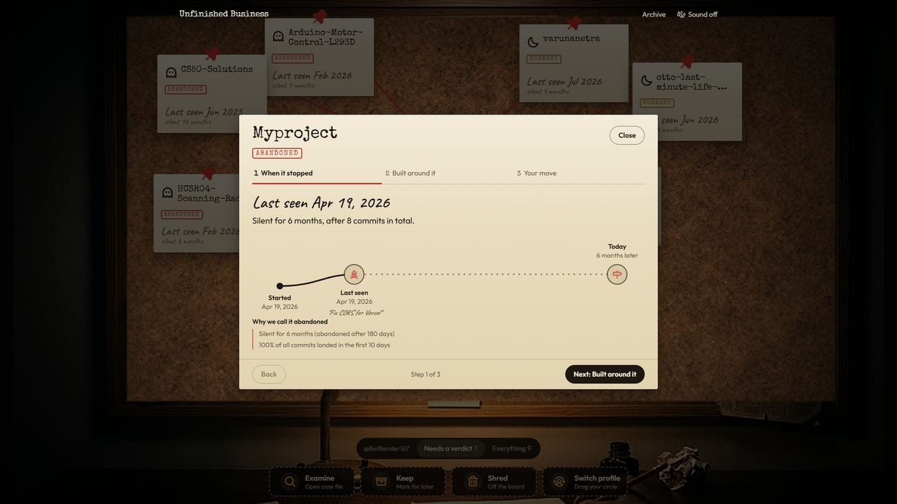
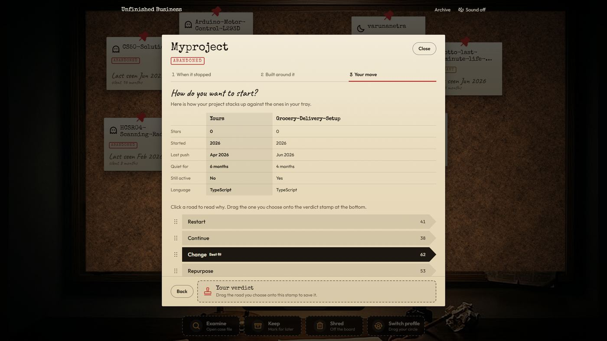
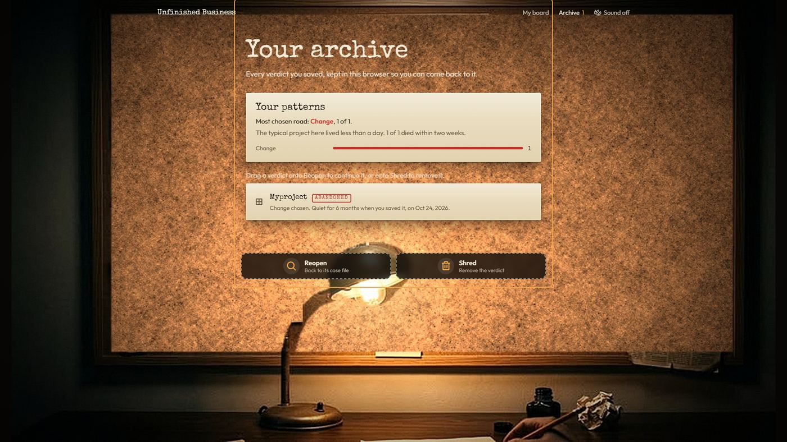

<div align="center">

# Unfinished Business

**Walk into your project graveyard. Drag one back to life.**

Enter a GitHub username and your abandoned repositories appear as notes on a cork board.
Drag a note onto a zone to examine it, then decide what it deserves: restart, continue, change, repurpose or archive.

[**Live demo**](https://botbender167.github.io/Ctrl-Alt-Elite-CodeVariant/) · [Source](https://github.com/BotBender167/Ctrl-Alt-Elite-CodeVariant)

Team **Ctrl Alt Elite** · Code Variant Build 01 · PS 05 "The Project Graveyard"



</div>

## What it does

Most of us have a folder of half-built things. Unfinished Business reads your public GitHub history and turns it into a case you can actually act on.

1. **Walk in.** Scroll to walk up to a haunted house. The door opens onto an investigation room.
2. **Scan yourself.** Drag your ID card onto the circle in the middle of the board.
3. **Read the board.** Every repository hangs off you by a red string, grouped by how dead it is.
4. **Open a case file.** Drag a note onto **Examine** to see when it stopped, who built something similar since, and how it compares.
5. **Decide.** Five roads, each scored with plain reasons and a first move. Drag the one you choose onto the verdict stamp. It is saved to your archive.

<table>
  <tr>
    <td></td>
    <td></td>
  </tr>
  <tr>
    <td></td>
    <td></td>
  </tr>
</table>

Every label and score is a plain rule you can read in [`src/config/rules.ts`](src/config/rules.ts) and [`src/lib/rules.ts`](src/lib/rules.ts). There is no black box.

## The Canvas Protocol (surprise challenge)

There are **no buttons for the primary actions**. Each one is a drag onto a labelled action zone.

| Action | You drag | Onto |
| --- | --- | --- |
| Scan a profile | Your ID card | The profile circle on the board |
| Open a project | A project note | **Examine** |
| Mark a project for later | A project note | **Keep** |
| Remove a project | A project note | **Shred** (Undo in the toast, or "Bring back" in the dock) |
| Scan someone else | Your profile circle | **Switch profile** |
| Compare similar projects | A similar project | The **compare tray** |
| Save a verdict | A road | The **verdict stamp** |
| Reopen or delete a verdict | An archive entry | **Reopen** or **Shred** |

Only navigation and previews stay as plain controls: Back and Next, Close, the filter tabs, Undo.

**It works without a mouse.** Tab to a card, **Enter** to pick it up, **arrow keys** to choose a zone, **Enter** to drop, **Escape** to cancel. Every step is announced to screen readers. On a phone, rows carry a grip handle so the page still scrolls.

The drag engine lives in [`src/features/dnd`](src/features/dnd) and is the only code that knows how dragging works.

## Run it

```bash
npm install
npm run dev        # http://localhost:5173
npm test           # unit tests
npm run lint
npm run build
npm run deploy     # builds and publishes to GitHub Pages
```

To host on Vercel, import the repository, keep the Vite preset and deploy (not yet done for this entry; the live demo is on GitHub Pages). [`vercel.json`](vercel.json) handles the single-page rewrite, security headers and media caching.

## Stack

| | |
| --- | --- |
| Vite, React 19, TypeScript | Static single-page app, nothing server-side has to be up |
| React Router | Deep links such as `/u/octocat/some-repo` open straight into a result |
| TanStack Query | Caching, de-duplication and retries for GitHub calls |
| Zustand (persisted) | The archive and settings, kept in `localStorage` |
| Zod | Every GitHub response is validated before the app trusts it |
| Tailwind CSS v4, Motion | Design tokens in `src/index.css`; motion that explains state changes |
| Vitest, Oxlint | Rules engine and proxy allow-list are pure functions with tests |

## Project layout

```text
src/config/rules.ts       thresholds, weights, labels (change the rules here)
src/lib/                  GitHub client, rules engine, relations, audio
src/room/                 scroll-scrubbed intro video and the investigation room
src/features/dnd/         drag-and-drop engine: pointer, keyboard, zones, announcements
src/features/board/       profile hub, notes, red strings, layout, dock
src/features/case/        three-step case file, compare tray, verdict stamp
src/pages/                Home, Board, Archive
api/                      optional serverless GitHub proxy and its allow-list
public/                   intro video (1080p and 1440p), room art, ambience loop
```

## How GitHub is called

- Scanning a user costs 1 request. Opening a project costs about 7. The "built around it" check costs 1 to 3 search requests.
- Protection: lazy loading, a 10 minute cache, request de-duplication, at most 4 parallel requests, typed errors and a visible notice when the quota runs low.
- More headroom: paste a token in the app (kept only in the browser), or deploy the optional proxy in [`api/github.ts`](api/github.ts) with `GITHUB_TOKEN` and `VITE_API_PROXY=/api/github`.

## Motion and accessibility

Every animation answers one question and stays under 500 ms. Only `transform` and `opacity` animate. `prefers-reduced-motion` skips the scroll walk, the flicker and the long drops. Sound is off until you turn it on, and switching it off silences it at once.

## Known limits

- Commit history shows effort, not intent, so the "cause of death" is a suggestion.
- Similar repositories are evidence, not proof that an idea was taken.
- Public repositories only. Without a token GitHub allows 60 requests an hour per network.
- The intro clip is a short third-party video, trimmed and re-encoded with a keyframe on every frame so scrolling can scrub it. Its licence is the open item to settle before this is more than a hackathon entry. The ambience is the team's own loop, and the creak, wind and hum are synthesised in the browser. The room artwork is supplied by the team.
